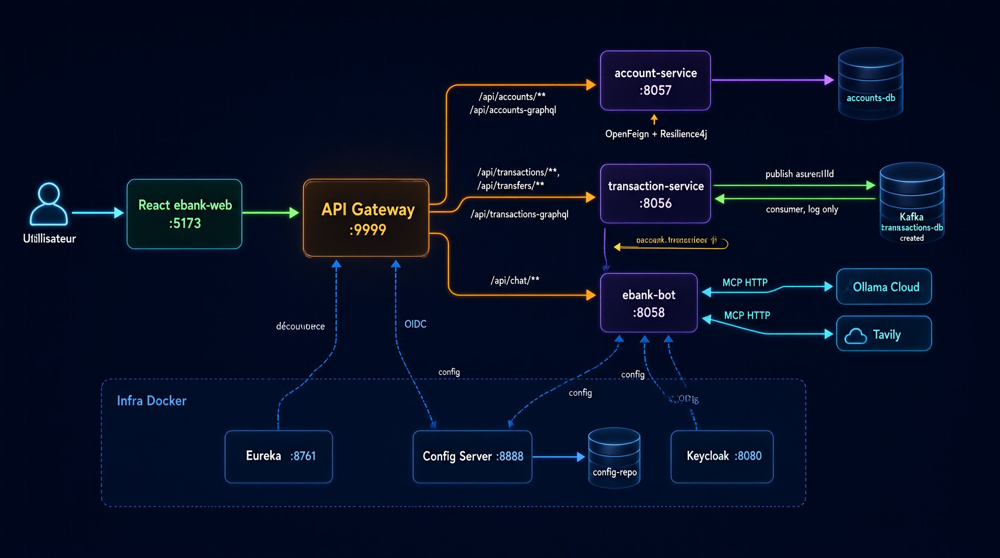
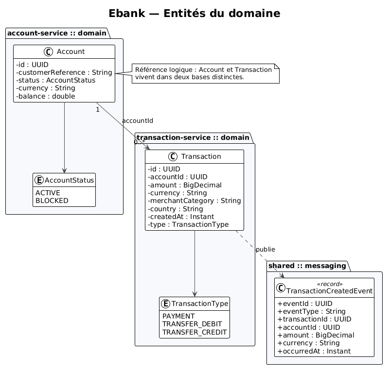
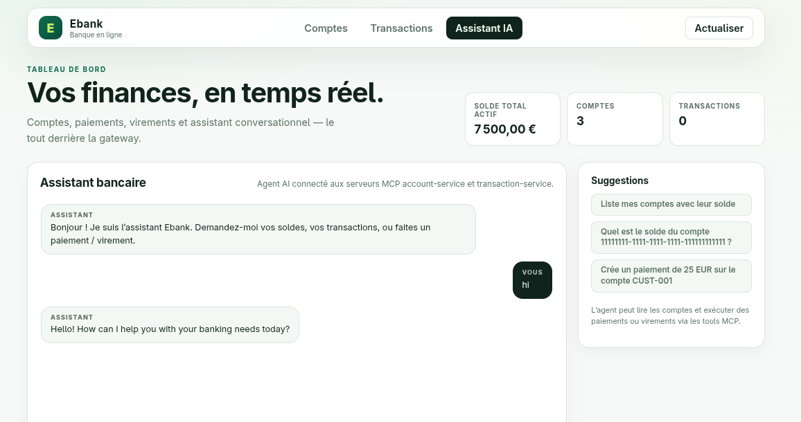
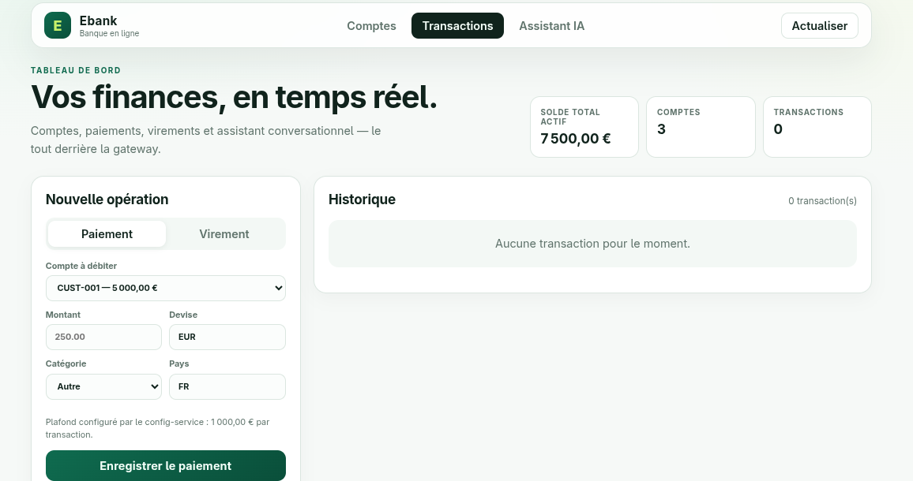
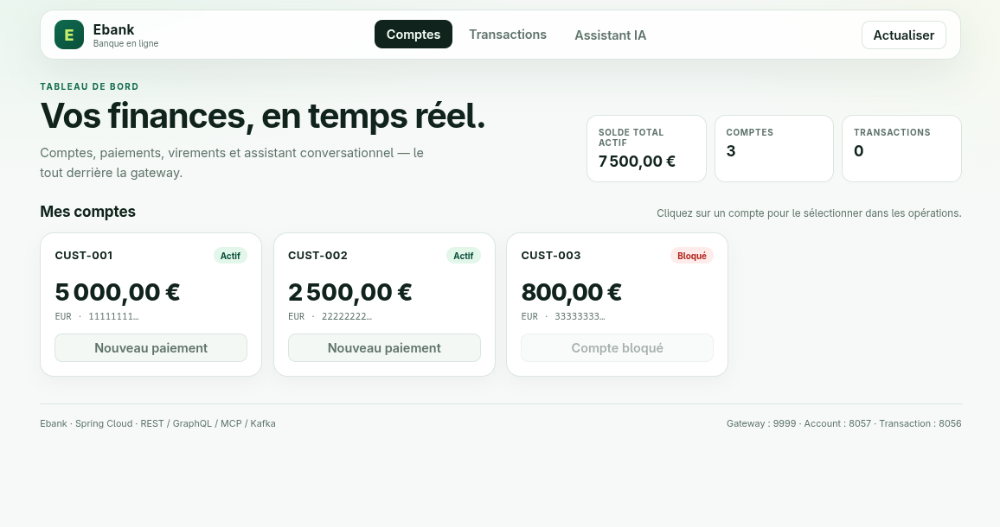
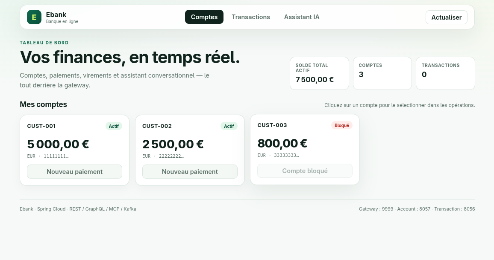
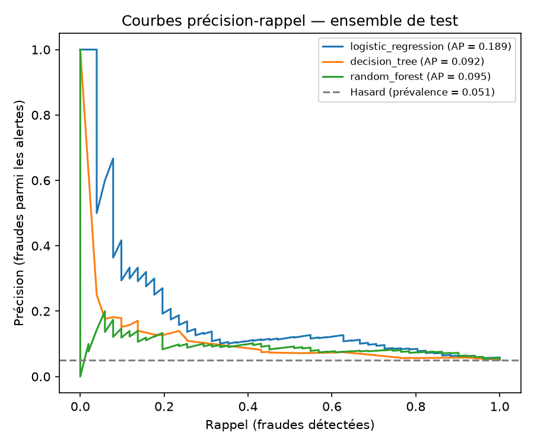
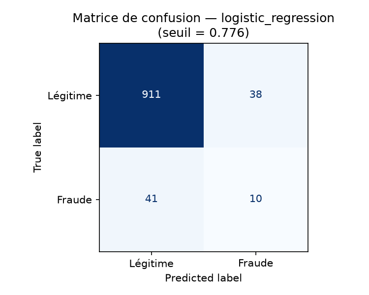

# Rapport : Épreuve technique de sélection

## Architecture micro-services, IA et développement full-stack

| | |
|---|---|
| **Candidat** | **Moussnaoui Ilyas** |
| **Épreuve** | Épreuve technique de sélection : Architecture micro-services, IA et développement full-stack |
| **Durée** | Épreuve pratique : 3 h |
| **Repository** | `moussnaoui-ilyas-test-adria-pfe-27` |
| **Stack** | Java 21 · Spring Boot 4 · Spring Cloud · Spring AI · Kafka · Keycloak · MariaDB · React · Python · Docker |

---

## Sommaire

1. [Partie A : Préparation](#partie-a--préparation)
2. [Partie B : Conception et architecture](#partie-b--conception-et-architecture)
3. [Partie C : Micro-services métier REST / GraphQL / MCP](#partie-c--micro-services-métier-rest--graphql--mcp)
4. [Partie D : Micro-services techniques](#partie-d--micro-services-techniques)
5. [Partie E : Chatbot agentique](#partie-e--chatbot-agentique)
6. [Partie F : Communication asynchrone Kafka](#partie-f--communication-asynchrone-kafka)
7. [Partie G : Client web React](#partie-g--client-web-react)
8. [Partie H : Détection de fraude en Python](#partie-h--détection-de-fraude-en-python)
9. [Partie I : DevOps](#partie-i--devops)
10. [Annexe : Liste des figures](#annexe--liste-des-figures)

---

## Partie A : Préparation

- Repository GitHub privé : `moussnaoui-ilyas-test-adria-pfe-27`.
- Projet Maven multi-modules :

```
ebank-app/
├── ansible/                  # déploiement (bonus)
├── .gitlab-ci.yml            # pipeline CI/CD
└── ebank-ms-app/
    ├── pom.xml               # config-service (racine)
    ├── src/                  # config-service
    ├── config-repo/          # configuration partagée servie par le Config Server
    ├── discovery-service/    # Eureka
    ├── gateway-service/      # Spring Cloud Gateway
    ├── account-service/      # comptes
    ├── transaction-service/  # transactions + virements
    ├── ebank-bot/            # agent AI + client MCP
    ├── ebank-web/            # client React (Vite + Nginx)
    ├── python/               # partie H (script, données, artefacts)
    ├── docker/               # init MariaDB
    ├── Dockerfile            # image commune à tous les services Java
    └── docker-compose*.yml   # stack complète
```

- Commits réguliers, Google Sheet rempli, repository rendu public en fin d'épreuve.
- Le présent rapport contient la réponse à chaque question et les captures des tests.

---

## Partie B : Conception et architecture

### 1. Architecture cible



*Schéma d'architecture de la plateforme.*

### 2. Diagramme des entités du domaine



*Entités du domaine et relations.*

### 3. Séparation des couches

Chaque service métier applique la même structure :

| Couche | Rôle |
|---|---|
| `domain/` | Entités JPA, enums (`Account`, `AccountStatus`, `Transaction`, `TransactionType`) |
| `repository/` | Interfaces Spring Data JPA |
| `service/` | **Règles métier : source unique de vérité** |
| `web/rest/` | Contrôleurs REST |
| `web/graphql/` | Contrôleurs GraphQL (`@QueryMapping`, `@MutationMapping`) |
| `mcp/` | Tools exposés au chatbot (`@Tool`) |
| `messaging/` | Producer / consumer Kafka |
| `client/` | Client OpenFeign + gateway de tolérance aux pannes |

> Les contrôleurs **REST, GraphQL et MCP appellent tous la même couche `service/`** :
> aucune règle métier n'est dupliquée dans les adaptateurs d'entrée.

### 4. Composants et ports

| Composant | Rôle | Port conteneur | Port hôte (dev) |
|---|---|---|---|
| `config-service` | Spring Cloud Config, backend natif `config-repo/` | 8888 | 8888 |
| `discovery-service` | Eureka | 8761 | 8761 |
| `gateway-service` | Point d'entrée unique REST/GraphQL/chat | 9999 | 9999 |
| `account-service` | Comptes, débits/crédits, consumer Kafka | 8057 | 8057 |
| `transaction-service` | Transactions, virements, producer Kafka | 8056 | 8056 |
| `ebank-bot` | Agent AI + client MCP | 8058 | 8058 |
| `ebank-web` | React servi par Nginx | 8080 | 5173 |
| `mariadb` | `accounts-db`, `transactions-db` | 3306 | 3306 |
| `kafka` | Broker KRaft | 19092 | 29092 |
| `keycloak` | Identité / OIDC | 8080 | 8180 |

---

## Partie C : Micro-services métier (REST, GraphQL, MCP)

### 1. `account-service`

**Modèle `Account`** : `id` (UUID), `customerReference`, `status` (`ACTIVE`/`BLOCKED`),
`currency`, `balance`.

**Règles métier** (`AccountService`) :

- création d'un compte avec statut/devise/solde ;
- débit refusé si montant ≤ 0, devise différente ou compte bloqué ;
- crédit avec les mêmes contrôles ;
- solde jamais négatif (`AccountOperationException`).

**REST**, base `/accounts` :

| Méthode | Chemin | Action |
|---|---|---|
| GET | `/accounts` | Liste des comptes |
| GET | `/accounts/{id}` | Détail |
| POST | `/accounts` | Création |
| POST | `/accounts/{id}/debit` | Débit |
| POST | `/accounts/{id}/credit` | Crédit |

**GraphQL**, `/graphql` (exposé via la gateway sur `/api/accounts-graphql`) :

```graphql
query { accounts { id customerReference status currency balance } }
query { account(id: "1111...") { balance } }
mutation { debitAccount(id: "1111...", input: { amount: 50, currency: "EUR" }) { balance } }
```

**MCP**, `/mcp` : `getAllAccounts`, `getAccountById`, `createAccount`, `debitAccount`, `creditAccount`.

### 2. `transaction-service`

**Modèle `Transaction`** : `id`, `accountId`, `amount` (`BigDecimal`), `currency`,
`merchantCategory`, `country`, `createdAt`, `type`.

**Règles métier** (`TransactionService`) :

- montant strictement positif et ≤ `bank.transaction.max-amount` (1000) ;
- le compte doit exister et être `ACTIVE` ;
- devise de la transaction = devise du compte ;
- consultation du solde du compte via **OpenFeign**, puis débit après persistance ;
- virement : débit du compte source + crédit du compte destinataire, deux transactions liées.

**REST** :

| Méthode | Chemin | Action |
|---|---|---|
| GET | `/transactions` | Toutes les transactions |
| GET | `/transactions/{id}` | Détail |
| GET | `/transactions/account/{accountId}` | Transactions d'un compte |
| POST | `/transactions` | Paiement |
| POST | `/transfers` | Virement |

Exemple :

```bash
curl -X POST http://localhost:9999/api/transactions \
  -H 'Content-Type: application/json' \
  -d '{"accountId":"11111111-1111-1111-1111-111111111111",
       "amount":250,"currency":"EUR",
       "merchantCategory":"FOOD","country":"FR"}'
```

**GraphQL**, via `/api/transactions-graphql` :

```graphql
query { transactions { id accountId amount type createdAt } }
mutation { createTransaction(input: { accountId: "...", amount: 100, currency: "EUR", merchantCategory: "FOOD", country: "FR" }) { id } }
```

**MCP**, `/mcp` : `createTransaction`, `transfer`, `listTransactions`,
`getTransaction`, `getAccountBalance`.

### 3. Communication inter-services : OpenFeign + Resilience4j

`transaction-service` appelle `account-service` via :

```java
@FeignClient(name = "account-service", path = "/accounts")
public interface AccountClient {
    @GetMapping("/{id}") AccountDto getAccount(@PathVariable UUID id);
    @PostMapping("/{id}/debit") AccountDto debit(...);
    @PostMapping("/{id}/credit") AccountDto credit(...);
}
```

Chaque appel est protégé par un `@CircuitBreaker(name = "accountService")` avec fallback :

- `account-service` indisponible → **HTTP 503** propre (`AccountServiceUnavailableException`) ;
- erreurs métier 400/404 → traduites en **400 Bad Request** ;
- configuration : fenêtre 10 appels, seuil d'échec 50 %, attente 10 s en état ouvert,
  3 appels autorisés en half-open, timeout 5 s.

---

## Partie D : Micro-services techniques

### 1. Spring Cloud Gateway (`:9999`)

Routes déclarées dans `gateway-service/src/main/resources/application.yml` :

| Route | Cible |
|---|---|
| `/api/accounts/**` | `lb://account-service` |
| `/api/transactions/**`, `/api/transfers/**` | `lb://transaction-service` |
| `/api/chat/**` | `lb://ebank-bot` |
| `/api/accounts-graphql` → `/graphql` | `lb://account-service` |
| `/api/transactions-graphql` → `/graphql` | `lb://transaction-service` |

La gateway s'appuie sur Eureka (`lb://`) : aucun hostname de service n'est codé en dur.

### 2. Eureka Discovery (`:8761`)

- `discovery-service` enregistre les instances ;
- les services se déclarent via `eureka.client.service-url.defaultZone` ;
- la gateway et OpenFeign résolvent les instances par leur nom logique.

### 3. Config Server (`:8888`)

- Backend **natif** sur le volume `config-repo/` monté en lecture seule.
- Configuration partagée servie à tous les services :

```properties
bank.transaction.max-amount=1000
app.kafka.transactions-topic=bank.transactions.created
```

- `transaction-service` refuse toute transaction > 1000.
- Vérification :

```bash
curl http://localhost:8888/transaction-service/dev
curl http://localhost:8056/actuator/env/bank.transaction.max-amount
```

---

## Partie E : Chatbot agentique

### 1. Agent AI

`ebank-bot` (Spring AI) :

- **LLM** : Ollama Cloud (modèle `gpt-oss:20b`), abstraction `AgentProvider`
  (remplaçable par Grok/OpenAI sans changer l'agent) ;
- **Tools bancaires** : découverts automatiquement via **MCP streamable HTTP**
  auprès de `account-service` et `transaction-service` ;
- **Tool web** : `webSearch` (Tavily) pour les informations à jour ;
- **Mémoire conversationnelle** : `MessageChatMemoryAdvisor` + identifiant de conversation ;
- **System prompt** : impose d'utiliser les tools pour toute donnée bancaire et de ne jamais
  inventer de données.

Tools utilisés par l'agent :

| Serveur MCP | Tools |
|---|---|
| `account-service` | lecture des comptes/soldes, création, débit, crédit |
| `transaction-service` | paiement, virement, liste/détail des transactions, solde |

### 2. Test du chatbot

```bash
# Client REST simple
curl 'http://localhost:9999/api/chat?query=Liste%20mes%20comptes'

# Client JSON
curl -X POST http://localhost:9999/api/chat \
  -H 'Content-Type: application/json' \
  -d '{"conversationId":"demo","message":"Quel est le solde du compte CUST-001 ?"}'
```

Le client React intègre aussi un onglet **Assistant IA** qui appelle ce endpoint.

> Le test demandé est réalisé avec un **client REST** (navigateur/curl/React).
> Les connecteurs Telegram/Discord ne sont pas implémentés : l'endpoint REST `POST /api/chat`
> peut servir de webhook si nécessaire.



*Conversation avec l'assistant IA depuis le client React (voir Partie G).*

---

## Partie F : Communication asynchrone Kafka

### 1. Publication

Après **persistance réussie** (et commit de la transaction), `transaction-service` publie
dans le topic `bank.transactions.created`, avec **`accountId` comme clé** :

```json
{
  "eventId": "UUID",
  "eventType": "TransactionCreated",
  "transactionId": "UUID",
  "accountId": "UUID",
  "amount": 250.00,
  "currency": "EUR",
  "occurredAt": "2026-01-15T10:30:00Z"
}
```

- `KafkaTemplate<String, Object>` + `JsonSerializer` ;
- publication dans `afterCommit()` pour ne jamais émettre un événement d'une transaction annulée ;
- clé = `accountId` → garantit l'ordre des événements d'un même compte sur une partition.

### 2. Consommation

`account-service` consomme le topic (groupe `account-service`) et **journalise uniquement**
l'événement, sans modifier les données bancaires :

```
TransactionCreatedEvent{eventId=..., transactionId=..., accountId=..., amount=250.00, currency=EUR}
```

Aucun débit/crédit n'est déclenché par le consumer : la mise à jour du solde reste
synchrone dans le flux métier (Feign), comme exigé.

---

## Partie G : Client web React

Client **React 19 + Vite 7**, servi par Nginx dans la stack Docker.

Fonctionnalités :

- tableau de bord : solde total actif, nombre de comptes/transactions ;
- liste des comptes avec statut `ACTIVE` / `BLOCKED` ;
- historique des transactions ;
- formulaire **paiement** et **virement** (plafond 1000 €) ;
- onglet **Assistant IA** connecté au chatbot ;
- proxy `/api` → gateway `http://gateway-service:9999` (même origine, pas de CORS).

```bash
# Développement local
cd ebank-web && npm install && npm run dev     # http://localhost:5173

# Dans Docker (dev overlay)
docker compose -f docker-compose.yml -f docker-compose.dev.yml up -d --build --wait
# http://localhost:5173
```

### Captures de l'application

| Tableau de bord | Comptes |
|---|---|
|  |  |

| Transactions | Assistant IA |
|---|---|
|  |  |

*Captures de l'application React servie sur `http://localhost:5173`.*

---

## Partie H : Détection de fraude en Python

Le travail est dans `python/` (hors module Maven) :

| Fichier | Rôle |
|---|---|
| `fraud_detection.py` | Script exécutable (chargement → évaluation) |
| `requirements.txt` | Dépendances (`pandas`, `scikit-learn`, `matplotlib`, …) |
| `data/bank_transactions.csv` | Dataset (5 000 lignes) |
| `artifacts/metrics.json` | Toutes les métriques |
| `artifacts/metrics.csv` | Tableau comparatif des modèles |
| `artifacts/model.joblib` | Pipeline retenu, réutilisable |
| `artifacts/01_eda.png` … `05_feature_importance.png` | Graphiques |

```bash
cd python
python -m venv .venv && source .venv/bin/activate
pip install -r requirements.txt
python fraud_detection.py
```

### 1. Démarche

1. **Chargement** du CSV et contrôle des types.
2. **EDA** : proportion de fraudes et valeurs manquantes.
3. **Séparation stratifiée** 80/20 (`train_test_split(..., stratify=y)`).
4. **Exclusion des identifiants** : `transaction_id`, `account_id` ne sont pas des features.
5. **Pipeline** `ColumnTransformer` + `Pipeline` :
   - imputation (`SimpleImputer`) ;
   - encodage des catégories (`OneHotEncoder`) ;
   - normalisation (`StandardScaler`) ;
   - ajustement **uniquement sur le train** (pas de fuite de données).
6. **Modèles** : régression logistique, arbre de décision, random forest
   (`class_weight="balanced"`).
7. **Évaluation** : précision, rappel, F1 de la classe fraude, matrice de confusion,
   average precision, ROC AUC.

Le **seuil de décision** est choisi par validation croisée stratifiée 5 folds
**sur le train uniquement** ; le test ne sert ni à entraîner ni à choisir le seuil.

### 2. Résultats

| Donnée | Valeur |
|---|---|
| Lignes | 5 000 |
| Fraudes | 257 (**5,14 %**) |
| Valeurs manquantes | `merchant_category` 84 · `average_amount_last_7d` 75 · `country` 66 |
| Train / test | 4 000 / 1 000 |
| Modèle retenu | **Régression logistique** |
| Average precision (test) | **0,1886** |
| ROC AUC (test) | **0,7234** |

**Test : régression logistique :**

| Seuil | Accuracy | Précision fraude | Rappel fraude | F1 fraude | VP | FP | VN | FN |
|---|---|---|---|---|---|---|---|---|
| 0,500 | 0,751 | 0,1221 | **0,6275** | 0,2045 | 32 | 230 | 719 | 19 |
| 0,7765 (choisi en CV) | **0,921** | **0,2083** | 0,1961 | 0,2020 | 10 | 38 | 911 | 41 |

> **Référence** : un modèle qui prédit toujours « légitime » obtient **94,9 %** d'accuracy.
> C'est précisément pour cela que l'accuracy seule est trompeuse.



*Courbes précision-rappel des trois modèles.*



*Matrice de confusion du modèle retenu.*

### 3. Réponses aux questions d'analyse

#### Q1. Pourquoi l'accuracy seule est-elle insuffisante ?

Parce que les classes sont **très déséquilibrées** (5,14 % de fraudes) : un modèle qui
prédit toujours « légitime » atteint **94,9 %** d'accuracy sans détecter une seule fraude.
L'accuracy mélange les deux types d'erreurs et masque les faux négatifs, qui sont les plus
coûteux en fraude. Il faut regarder la **précision et le rappel de la classe fraude**,
le **F1**, la **matrice de confusion** et l'**average precision / PR-AUC**, qui évaluent
spécifiquement la capacité à retrouver la classe minoritaire.

#### Q2. Quel compromis existe entre faux positifs et fraudes non détectées ?

- **Faux positif** : transaction légitime bloquée → friction client, perte de confiance,
  coût de vérification manuelle.
- **Faux négatif** (fraude non détectée) : perte financière directe, remboursement,
  risque de conformité et de réputation.

Les deux se déplacent en sens inverse via le **seuil de décision**. En fraude, on privilégie
généralement le **rappel** (détecter un maximum de fraudes) tout en bornant les faux positifs
par une capacité de revue manuelle et un coût métier acceptable. Le seuil optimal dépend
donc d'une **matrice de coûts** (coût d'une fraude manquée vs coût d'une vérification).

#### Q3. Quel est l'effet possible d'une diminution du seuil de décision ?

Baisser le seuil rend le modèle **plus sensible** : davantage de transactions sont classées
« fraude ».

- **Rappel ↑** : plus de fraudes détectées ;
- **Faux positifs ↑** et **précision ↓** : plus de clients légitimes bloqués ;
- **F1** peut augmenter ou diminuer selon le point de fonctionnement.

Sur ce jeu de test, passer du seuil 0,7765 à 0,5 fait passer le rappel de **19,6 % à 62,8 %**
mais la précision de **20,8 % à 12,2 %** (faux positifs de 38 à 230). C'est un choix métier :
mieux vaut-il bloquer plus de transactions légitimes pour rattraper 3 fois plus de fraudes ?

#### Q4. Pourquoi privilégier une validation temporelle sur des données bancaires réelles ?

Parce que les données bancaires sont **temporelles** et **non stationnaires** : habitudes
clients, marchands, pays et techniques de fraude évoluent. Une séparation aléatoire mélange
passé et futur et **fuite d'information** : le modèle s'entraîne sur des transactions
postérieures à celles du test, ce qui surestime ses performances en production.

Une validation temporelle (entraînement sur le passé, test sur une période future, ou
**walk-forward / fenêtre glissante**) reproduit les conditions réelles de déploiement,
mesure la **dérive** (data drift) et permet de réentraîner le modèle à intervalles réguliers.

---

## Partie I : DevOps

### 1. Dockerfile unique pour tous les micro-services

`ebank-ms-app/Dockerfile` est un **multi-stage partagé** par les six modules Java.
Le module et le port sont passés en arguments :

```bash
docker build --build-arg MODULE=account-service --build-arg PORT=8057 -t ebank-ms/account-service .
docker build --build-arg MODULE=.               --build-arg PORT=8888 -t ebank-ms/config-service .
```

- étape `build` : Maven + JDK 21, cache BuildKit `~/.m2`, `mvn package` ;
- étape `runtime` : JRE 21, utilisateur non-root, `curl` pour les healthchecks,
  `-XX:MaxRAMPercentage=65`, `-XX:+ExitOnOutOfMemoryError`.

Le client React possède son propre `ebank-web/Dockerfile` (Node/Vite → Nginx).

### 2. Docker Compose

`docker-compose.yml` contient **toute** l'application :

| Service | Rôle |
|---|---|
| `mariadb` | `accounts-db`, `transactions-db` (volume `mariadb-data`) |
| `kafka` | broker KRaft, topic `bank.transactions.created` (volume `kafka-data`) |
| `keycloak` | identité / OIDC (volume `keycloak-data`) |
| `config-service` | configuration partagée |
| `discovery-service` | Eureka |
| `gateway-service` | point d'entrée |
| `transaction-service` | transactions + producer Kafka |
| `account-service` | comptes + consumer Kafka |
| `ebank-bot` | agent AI + MCP |
| `ebank-web` | React + Nginx |

```bash
# Développement (ports publiés sur 127.0.0.1 uniquement)
docker compose -f docker-compose.yml -f docker-compose.dev.yml up -d --build --wait

# Production (web 80 + gateway 9999, conteneurs durcis, limites mémoire)
docker compose -f docker-compose.yml -f docker-compose.prod.yml up -d --build --wait
```

Points clés :

- `depends_on: condition: service_healthy` : MariaDB/Kafka → config/Eureka → métier → bot → web ;
- healthchecks `/actuator/health`, `restart: unless-stopped`, `stop_grace_period: 30s` ;
- `SPRING_PROFILES_ACTIVE` forcé par l'overlay (`dev` / `pro`) ;
- en production : `read_only`, `cap_drop: ALL`, `no-new-privileges`, `tmpfs /tmp`, limites mémoire ;
- images taguées par commit (`IMAGE_TAG`) et récupérables d'un registre (`IMAGE_PREFIX`).

### 3. Pipeline CI/CD

Pipeline **GitLab CI** (`.gitlab-ci.yml`) : `detect → build → test → publish → deploy`.

```yaml
stages: [.pre, build, test, publish, deploy]

build:
  stage: build
  image: maven:3.9-eclipse-temurin-21
  script:
    - cd ebank-ms-app
    - ./mvnw -B -DskipTests package
    - for m in discovery-service gateway-service account-service transaction-service ebank-bot; do
        (cd "$m" && ../mvnw -B -DskipTests package);
      done

test:
  stage: test
  script: [cd ebank-ms-app, ./mvnw -B test]   # tests autonomes (H2, sans config server)

publish-images:
  stage: publish
  image: docker:27-cli
  services: [docker:27-dind]
  script:
    - echo "$CI_REGISTRY_PASSWORD" | docker login -u "$CI_REGISTRY_USER" --password-stdin "$CI_REGISTRY"
    - cd ebank-ms-app
    - docker build --build-arg MODULE=account-service --build-arg PORT=8057
        -t "$CI_REGISTRY_IMAGE/account-service:$CI_COMMIT_SHORT_SHA" .
    - docker push "$CI_REGISTRY_IMAGE/account-service:$CI_COMMIT_SHORT_SHA"
    # idem pour config, discovery, gateway, transaction, bot + image React

deploy:
  stage: deploy
  image: alpine/ansible
  script:
    - cd ansible
    - ansible-playbook -i inventory.yaml playbook.yaml -e "deploy_mode=$DEPLOY_MODE"
```

Le job `detect` compare les fichiers modifiés : si **seul `config-repo/`** change,
les conteneurs sont simplement redémarrés (pas de rebuild).

### 4. Réponses courtes

#### a) Gestion des secrets et distinction avec la configuration

- **Configuration** : valeurs non sensibles, versionnées et partagées via
  `config-repo/*.properties` + Config Server (`bank.transaction.max-amount=1000`,
  topic Kafka, timeouts, URLs internes).
- **Secrets** : jamais dans Git ni dans l'image. `.env` est ignoré ; `.env.example`
  ne contient que des placeholders. En CI : variables GitLab **masked/protected**.
  En production : gestionnaire de secrets (Vault, AWS/GCP Secret Manager, Kubernetes Secret)
  injecté en variables d'environnement.
- Séparation : la config est **réutilisable et auditable**, les secrets sont **rotatifs**
  sans rebuild (changement dans le gestionnaire + redémarrage).
- Rotation : nouvelle valeur → redémarrage du service ; aucune image à reconstruire.

#### b) Contrôles de démarrage, de disponibilité et de vitalité

- **Startup** : `depends_on: condition: service_healthy` garantit l'ordre de démarrage
  (MariaDB/Kafka → config/Eureka → services métier → bot → web).
- **Liveness** : `/actuator/health/liveness` → si le processus ne répond plus, il est redémarré.
- **Readiness** : `/actuator/health/readiness` → le service ne reçoit du trafic que
  lorsqu'il est prêt (DB, découverte, etc.).
- En Compose : healthcheck `/actuator/health` avec `interval`, `timeout`, `retries`,
  `start_period`. En Kubernetes : `startupProbe`, `livenessProbe`, `readinessProbe`.
- `server.shutdown=graceful` + `stop_grace_period: 30s` pour finir les requêtes en cours.

#### c) Logs, métriques et traces distribuées

- **Logs** : stdout/stderr, driver `json-file` avec rotation (`max-size: 10m`,
  `max-file: 3`). En production : Loki/ELK + identifiant de corrélation.
- **Métriques** : Spring Boot Actuator + Micrometer, exposés sur `/actuator/metrics`
  et `/actuator/prometheus`, collectés par **Prometheus** et visualisés dans **Grafana**
  (latence, taux d'erreur, saturation, débit).
- **Traces** : Micrometer Tracing + **OpenTelemetry**, propagation `traceId`/`spanId`
  entre la gateway, les services et Kafka ; export vers **Tempo/Jaeger**. Les appels
  Feign et les messages Kafka sont instrumentés.

#### d) Stratégie de rollback

1. Images **immuables** taguées par commit (`:$CI_COMMIT_SHORT_SHA`) + tag `latest`.
2. Rollback applicatif : redéployer le tag précédent
   (`IMAGE_TAG=<sha-précédent> docker compose ... up -d --no-build`) ou `git revert` + pipeline.
3. Migrations de base **rétrocompatibles** (expand/contract) pour qu'un ancien binaire
   tourne avec le nouveau schéma.
4. Volumes MariaDB/Kafka/Keycloak persistants + **sauvegarde** avant déploiement risqué.
5. En cas d'échec : `docker compose ... down`, redéploiement du tag stable ; healthchecks
   et `restart: unless-stopped` limitent l'indisponibilité.

---

## Annexe : Liste des figures

| # | Fichier | Contenu |
|---|---|---|
| 1 | `images/01-architecture.png` | Schéma d'architecture |
| 2 | `images/02-class-diagram.png` | Diagramme des entités |
| 3 | `images/react-01.png` | Application React : tableau de bord |
| 4 | `images/react-02.png` | Application React : comptes |
| 5 | `images/react-03.png` | Application React : transactions |
| 6 | `images/react-04.png` | Application React : assistant IA |
| 7 | `python/artifacts/02_precision_recall.png` | Courbes précision-rappel |
| 8 | `python/artifacts/03_confusion_matrix.png` | Matrice de confusion |
